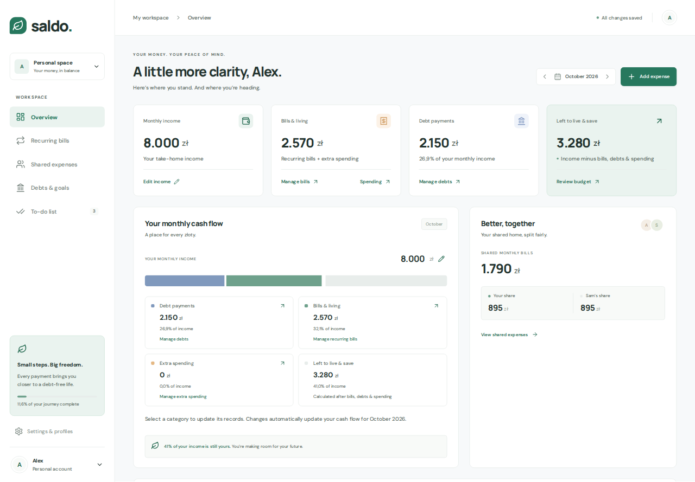

# Saldo

[](https://github.com/SkyOne771/saldo/actions/workflows/ci.yml)

**A self-hosted finance dashboard that replaces a household spreadsheet with a clear monthly view.**

Saldo brings recurring bills, 50/50 shared expenses, debt repayments, cash flow and everyday tasks into one application. It runs locally or on a Linux VPS, with data stored in your own SQLite database.



## What it does

- **One Overview:** monthly income, bills, debt commitments, remaining budget and editable extra spending, with shortcuts to their source records.
- **Recurring and shared bills:** monthly/yearly schedules, days 1–31, selected partners, month-specific payers, equal splits with cent reconciliation, and imports between lists without duplicates.
- **Independent list visibility:** remove a bill from either list, undo or restore it, while preserving its budget, split and payment history.
- **Month history:** income and bill changes take effect from the selected month; paid settlement snapshots protect earlier payments from later edits.
- **Debt progress:** track principal repayments, correct or delete them with balance adjustments, and customise a coloured milestone grid.
- **Profiles and tasks:** separate budget views within one account, tasks with statuses, six colour themes, and light/dark/system appearance.
- **Account controls:** invitation-based registration, private accounts, recovery codes, session revocation, and JSON export/restore. New accounts start empty.

## Try it locally

Install **Node.js 22.13 or newer** and npm, then:

```bash
git clone https://github.com/SkyOne771/saldo.git
cd saldo
npm ci
npm run dev
```

Open [localhost:3000](http://localhost:3000). Development starts a local demo using fictional **Alex and Sam** profiles. No account or external API is required. The demo persists in `data/`; keep this mode local.

For private accounts, run `DEMO_MODE=false npm run dev`, then issue an invitation as described in the [deployment guide](docs/DEPLOYMENT.md). Production refuses demo mode.

## Engineering decisions

| Concern           | Implementation                                                                        |
| ----------------- | ------------------------------------------------------------------------------------- |
| Frontend          | React, Vite, plain CSS and Lucide icons                                               |
| API               | Express on Node.js 22                                                                 |
| Persistence       | Built-in SQLite, WAL mode and account-scoped state                                    |
| Concurrent edits  | Optimistic revisions plus three-way draft recovery                                    |
| Financial history | Effective-month changes and snapshots for paid bills                                  |
| Authentication    | Salted scrypt, hashed session tokens, session-bound CSRF protection                   |
| Hosting           | Docker Compose or isolated systemd service behind Caddy/HTTPS                         |
| Quality           | Model/API regression tests, build checks, generated docs and publication checks in CI |

The [architecture guide](docs/ARCHITECTURE.md) explains the data flow, tradeoffs and boundaries. This is a personal budgeting tool: it does not connect to banks, move money or calculate an automatic loan amortisation schedule.

## Run in production

```bash
npm ci
npm run build
npm start
```

Production requires sign-in and an invitation for signup. Set the canonical origin and secure cookies when using HTTPS. Docker, VPS, reverse-proxy, invitation, recovery and backup instructions are in [Deployment](docs/DEPLOYMENT.md). Never commit runtime databases, backups, `.env` files or account credentials.

## Validate a change

```bash
npm run docs:generate
npm run check
```

`check` verifies generated documentation, repository-local links, the public file set, model/API tests and the production build. CI also requires a documentation change for application changes. Browser checks are documented separately; the Node test command does not launch a browser.

## Documentation

- [User guide](docs/USER_GUIDE.md) — budget rules, profiles, history, imports and corrections.
- [Architecture](docs/ARCHITECTURE.md) — client/API/storage design and deliberate limits.
- [Deployment](docs/DEPLOYMENT.md) — local, Docker, HTTPS, backups and account administration.
- [Generated code reference](docs/REFERENCE.md) — current routes, configuration names, navigation and commands.
- [Testing](docs/TESTING.md) — automated coverage and browser verification procedure.
- [Security policy](SECURITY.md) — protections, limitations and private reporting.
- [Contributing](CONTRIBUTING.md) — checks and documentation maintenance.
- [Changelog](docs/CHANGELOG.md) — notable behavior changes.

## Portfolio summary

> Developed a self-hosted finance application using React, Express and SQLite, with household expense splitting, effective-month financial history, debt tracking, optimistic concurrency recovery, and automated regression and documentation checks.

Use this wording as a factual starting point for a résumé. The repository demonstrates the implementation; it does not imply bank integration, financial certification or an independent security audit.

## License

Licensed under the [MIT License](LICENSE), permitting reuse with the copyright and license notice retained. All sample identities and figures in the public source and screenshot are fictional. Private account data and deployment credentials are excluded from the repository.
