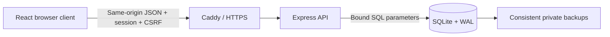

# Architecture

Saldo is a small self-hosted application for an individual or household. It deliberately uses one deployable Node service and one SQLite database.

During development Vite middleware is served by the same Express process. In production Express serves the built `dist/` assets. A reverse proxy can mount the application at `/` or a prefix such as `/finance/`.

## Code map

| Area                                                         | Source                                                                                 |
| ------------------------------------------------------------ | -------------------------------------------------------------------------------------- |
| HTTP routes, authentication, storage and security middleware | [server.mjs](../server.mjs)                                                            |
| Budget, split, history and repayment rules                   | [model.mjs](../src/model.mjs)                                                          |
| Main application and record editors                          | [main.jsx](../src/main.jsx)                                                            |
| Shared/recurring list management                             | [BillsPanel.jsx](../src/BillsPanel.jsx)                                                |
| Three-way merge and recovery UI                              | [merge.mjs](../src/merge.mjs), [ConflictRecovery.jsx](../src/ConflictRecovery.jsx)     |
| Themes and accessible dialogs                                | [appearance.mjs](../src/appearance.mjs), [useDialog.js](../src/useDialog.js)           |
| Debt grid and account recovery                               | [DebtTracker.jsx](../src/DebtTracker.jsx), [RecoveryForm.jsx](../src/RecoveryForm.jsx) |

## Account isolation and state

Each authenticated user owns a JSON finance state and a revision in SQLite. The server derives the account from its session; requests cannot select a different account ID. The state contains profiles, bills, debts, repayments, expenses and tasks. Profiles are budgeting views within an account, not separate logins or permission boundaries.

This aggregate makes account export/restore and local hosting straightforward. The tradeoff is that writes replace the account aggregate rather than updating a normalised ledger. State size, collection sizes, references, monetary precision and revisions are validated. This design targets small household datasets, not high-volume transactions or analytics.

## History and calculations

Income and bill terms have effective-month changes. A query for a month selects the last applicable change. Marking a bill paid captures its amount, participants and payer for that month. Later edits do not rewrite those paid settlements; an intentional correction to the selected paid month is possible.

The planned monthly budget subtracts the profile's bill share, active monthly debt commitments and selected-month extra spending from income. Annual bills are provisioned at one twelfth of their amount. Principal repayment records reduce remaining debt but do not subtract the planned instalment a second time. Amounts are validated to cent precision and calculations round money where needed. No interest/amortisation engine or bank reconciliation is implied.

## Concurrent changes

Every state write includes the revision read by that tab. SQLite updates only the matching account/revision. A stale write returns a conflict. The client keeps the draft, fetches the current state and offers a three-way merge: independent changes combine, while overlapping values require a choice. A draft can also be downloaded.

## Security and deployment boundaries

Authentication uses asynchronous salted scrypt and random sessions stored as digests. Authenticated mutations require a session-specific CSRF token, a custom header and same-origin checks. Recovery codes and invitations are private, hashed and single-use. See [SECURITY.md](../SECURITY.md) for limits, expiry and threat boundaries.

Production assets, account state, authentication metadata and backups have distinct roles. Runtime data is excluded from Git and the web document root. A systemd deployment can confine the service to private data/backup directories; Docker provides an alternative with a persistent volume and restricted container privileges.

A separate hostname is preferable when hosting multiple applications: URL paths are not a browser security boundary. SQLite backups should be copied off the host. The application is not encrypted at rest by itself.
